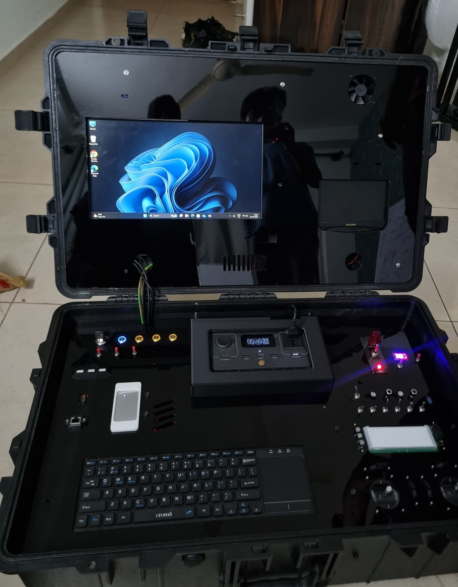

Arctus builds high-altitude UAVs. I interned there three times, in December 2024, June 2025 and December 2025.

## Ground control station

I designed and built a modular ground control station, from system integration and wiring through to the enclosure. Everything packs into one rugged case. It supports manual and autonomous flight, real-time telemetry, FPV video and in-flight tuning.

*The finished station, with displays in the lid and power, switches, a keyboard and the flight sticks in the base.*

## Onboard electronics

I also designed multilayer PCBs and wrote STM32 firmware for the fuel, propulsion, braking, steering and battery systems, and reverse-engineered the software of a paramotor engine.
