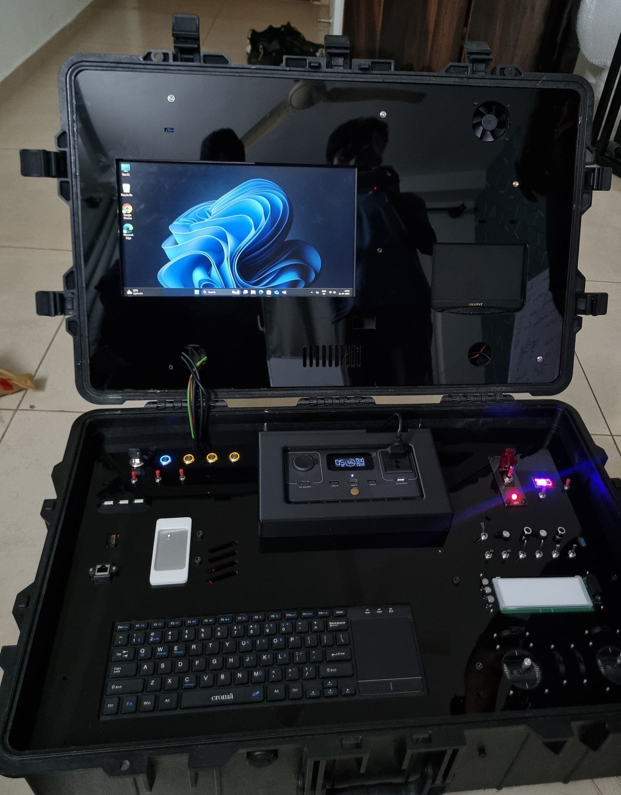

## Ground control station

I architected and built a **modular ground control station** for high-altitude UAVs, from system integration and wiring to the enclosure. Everything packs into one rugged case, and it supports manual and autonomous flight, real-time telemetry, FPV video and in-flight tuning.

*The finished station: displays in the lid; power, switches, a keyboard and the flight sticks in the base.*

## Onboard electronics

- Designed **multilayer PCBs and STM32 firmware** for the fuel, propulsion, braking, steering and battery systems.
- Reverse-engineered **paramotor engine software**.
